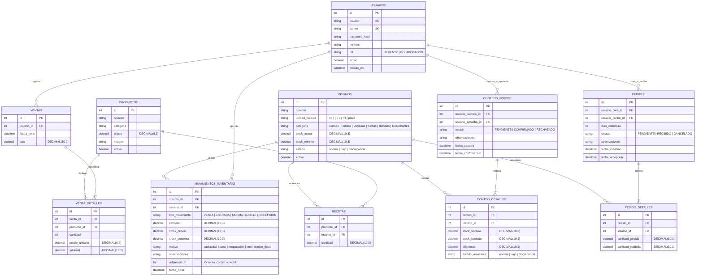

# Contrato Técnico — Tacos Tony Inventario Móvil

| Campo | Valor |
|---|---|
| Equipo / Autor(es) | Fernando León Del Río — Equipo 4 (Tacos Tony) |
| Versión | 2.0 |
| Fecha | 2026-11-21 |
| Documento de origen | [01-vision-alcance_TacosTonyMovil_Leon.md](./01-vision-alcance_TacosTonyMovil_Leon.md) · [InstruccionesEtapa4.md](./InstruccionesEtapa4.md) |
| Versión anterior | [02-contrato-tecnico_TacosTonyMovil_Leon_v1.1.md](./02-contrato-tecnico_TacosTonyMovil_Leon_v1.1.md) (v1.1, se conserva como historial) |
| Estado | Final / Aprobado (Etapa 4) |

> **Nota de la versión 2.0:** Evolución final sobre la versión `v1.1`. Incorpora: (1) el cambio solicitado por el cliente (**RF-17: Conteo físico con conciliación**, flujo Colaborador borrador → Gerente aprueba/concilia o Gerente confirma directo, con cálculo atómico ante ventas concurrentes y movimientos inmutables `AJUSTE`); (2) los requisitos pendientes del producto (**RF-11** a **RF-16**: reabastecimiento sugerido de 7 días, pedidos de compra, recepción con movimiento `RECEPCION`, importación masiva CSV de ventas, reporte analítico de consumo vs. merma y exportación CSV con BOM UTF-8); y (3) la sincronización de ADR-01/ADR-03 y Sección 8 con la interfaz implementada (`app.php` Mobile-First + API REST PHP 8 en `/3478788/login/`). Se retira explícitamente cualquier exclusión de ajustes tras conteo físico en Fuera de Alcance.

> **Propósito de este documento:** Definir de forma verificable qué hace el sistema completo (`v2.0`), qué criterios *Given/When/Then* garantizan su funcionamiento y qué decisiones técnicas gobiernan el código desplegado y la futura extensión móvil de la Etapa 6 (SSOT junto con [04-validacion-entrega-final_TacosTonyMovil_Leon.md](./04-validacion-entrega-final_TacosTonyMovil_Leon.md)).

---

## 1. Contexto y Alcance Final del Sistema (`v2.0`)

Tacos Tony Inventario Móvil es una aplicación web *mobile-first* para los colaboradores y el gerente de la sucursal Tacos Tony Camino Real. Digitaliza el control de existencias desde celulares en cocina y bodega, descuenta insumos en tiempo real mediante recetas (`DECIMAL(10,3)`), automatiza sugerencias y recepción de pedidos, permite importar ventas por CSV, genera reportes analíticos y concilia conteos físicos semanales mediante movimientos inmutables (`AJUSTE`), manteniendo la trazabilidad total de auditoría (`RNF-06`).

### Alcance Completo (`v2.0` — 17 de 17 RF)

| ID | Requisito (título corto) | Prioridad | ¿Entra en v2.0? | Versión en que ingresó |
|---|---|---|---|---|
| RF-01 | Autenticación y control de acceso RBAC | Debe | Sí | v1.0 / v1.1 (MVP) |
| RF-02 | Catálogo de insumos y desactivación lógica | Debe | Sí | v1.0 / v1.1 (MVP) |
| RF-03 | Configuración de recetas por producto | Debe | Sí | v1.0 / v1.1 (MVP) |
| RF-04 | Captura manual de ventas | Debe | Sí | v1.0 / v1.1 (MVP) |
| RF-05 | Descuento por receta y discrepancias | Debe | Sí | v1.0 / v1.1 (MVP) |
| RF-06 | Registro de entradas por compra | Debe | Sí | v1.0 / v1.1 (MVP) |
| RF-07 | Registro de mermas con motivo | Debe | Sí | v1.0 / v1.1 (MVP) |
| RF-08 | Consulta de existencias móvil y filtros | Debe | Sí | v1.0 / v1.1 (MVP) |
| RF-09 | Alertas de stock bajo en dashboard | Debe | Sí | v1.0 / v1.1 (MVP) |
| RF-10 | Historial inmutable de movimientos | Debe | Sí | v1.0 / v1.1 (MVP) |
| RF-11 | Lista sugerida de reabastecimiento (7 días) | Debería | Sí | **v2.0 (Etapa 4)** |
| RF-12 | Generación y ajuste de pedidos de compra | Debería | Sí | **v2.0 (Etapa 4)** |
| RF-13 | Confirmación de recepción de pedido (`RECEPCION`) | Debería | Sí | **v2.0 (Etapa 4)** |
| RF-14 | Importación masiva de ventas vía CSV | Debería | Sí | **v2.0 (Etapa 4)** |
| RF-15 | Reporte analítico de consumo y merma por periodo | Debería | Sí | **v2.0 (Etapa 4)** |
| RF-16 | Exportación de reportes, conteos e historial a CSV | Podría | Sí | **v2.0 (Etapa 4)** |
| **RF-17** | **Conteo físico con conciliación (`AJUSTE` + aprobación)** | **Debe (Cliente)** | **Sí** | **v2.0 (Etapa 4)** |

---

## 2. Decisiones de Arquitectura Vigentes (ADR)

### ADR-01 — Arquitectura desacoplada API-First (Backend REST en PHP 8 + Cliente Web Mobile-First sin compilación) — *Actualizada en v2.0*

- **Contexto:** El despliegue se realiza en hosting compartido (`https://equipo4.centrofuyuan.com/3478788/login/`) con PHP 8 por petición y subida directa vía FTPS. La arquitectura debe exponer contratos JSON limpios reutilizables para el futuro complemento móvil (Etapa 6).
- **Decisión:** Se mantiene el enfoque **API-First desacoplado**: toda la lógica de negocio y seguridad reside en `login/api/index.php` (JSON puro con JWT), mientras la interfaz web responsive (`login/app.php` + `login/styles.css` + JavaScript nativo vía `fetch`) consume exclusivamente los endpoints REST de la API sin requerir Node.js ni paso de compilación (*build*) para actualizar el hosting.
- **Estado en v2.0:** **Modificada respecto a v1.1** — se reemplazó la etapa de compilación React/Vite por cliente web SPA-like en JavaScript nativo servido desde `app.php`, manteniendo intactos los contratos JSON para la app móvil de la Etapa 6.

### ADR-02 — Base de datos relacional MySQL InnoDB con transacciones ACID y `DECIMAL(10,3)` — *Sin cambios*

- **Decisión:** Base de datos relacional `uzfjkpte_equipo4` (motor InnoDB) con tablas prefijadas `3478788_*`, claves foráneas, bloqueo pesimista `SELECT ... FOR UPDATE` en ventas, entradas, mermas, recepciones y conciliación de conteos físicos, y precisión fija `DECIMAL(10,3)`.
- **Estado en v2.0:** **Vigente sin cambios**; ampliada de 7 a 12 tablas físicas para soportar `conteos_fisicos`, `conteo_detalles`, `pedidos`, `pedido_detalles` y `proveedores`.

### ADR-03 — Interfaz Mobile-First táctil (`>= 48x48 px`), paleta corporativa y sub-pestañas — *Actualizada en v2.0*

- **Decisión:** CSS corporativo propio (`login/styles.css`) alineado a la identidad visual oficial de Tacos Tony (`#F6821F`, `#073A79`, `#F9D864`), áreas táctiles mínimas de `48x48 px` (`RNF-04`), cero desplazamiento horizontal desde `360 px` (`RNF-03`), barra de navegación inferior fija (`5` pestañas para `GERENTE`, `3` para `COLABORADOR`) y sub-pestañas táctiles envolventes para agrupar los nuevos módulos (`RF-11` a `RF-17`) sin saturar el ancho de `360 px`.
- **Estado en v2.0:** **Modificada respecto a v1.1** — se optó por CSS propio puro (< 22 KB) con paleta institucional de Tacos Tony y sub-pestañas en `app.php` en lugar de Tailwind/React compilado.

### ADR-04 — Autenticación Stateless JWT (HS256) + RBAC en middleware + `.env` — *Sin cambios en diseño, ampliada a nuevos roles/rutas*

- **Decisión:** Token JWT HS256 con expiración de 30 minutos (`1800 s`), `bcrypt` costo 10 (`password_hash`), secretos exclusivamente en `.env` (bloqueado en `.htaccess` y excluido en `.gitignore`), y autorización granular por endpoint mediante `authenticateToken()` y `authorizeRole()`.
- **Ampliación en v2.0:** `COLABORADOR` recibe acceso explícito a captura de borrador en `POST /api/conteos` (`RF-17`, sin alterar stock) y confirmación de recepción en `POST /api/pedidos/:id/recibir` (`RF-13`), manteniendo bloqueadas en backend las rutas de aprobación de conteos, altas, recetas, ventas, mermas y reportes analíticos (`403 Forbidden`).

### ADR-05 — Backend en PHP 8 sin framework por restricciones de hosting compartido — *Sin cambios*

- **Decisión:** Front controller `api/index.php` en PHP 8 nativo con PDO (`ATTR_EMULATE_PREPARES => false`), soporte `_method` para clientes/proxies restrictivos y migración automática idempotente en `init_mvp.php`.

---

## 3. Modelo de Datos e Interfaces (`v2.0`)

### 3.1 Modelo de Datos (12 Tablas Físicas `3478788_*` · 32 insumos · 38 productos · 8 proveedores)



> **Prefijos físicos reales en MySQL (`uzfjkpte_equipo4`):** `3478788_usuarios`, `3478788_insumos`, `3478788_productos`, `3478788_recetas`, `3478788_ventas`, `3478788_venta_detalles`, `3478788_movimientos_inventario`, `3478788_conteos_fisicos`, `3478788_conteo_detalles`, `3478788_pedidos`, `3478788_pedido_detalles` y `3478788_proveedores`.

---

### 3.2 Contratos de Interfaz (API RESTful)

> **URL base en producción:** `https://equipo4.centrofuyuan.com/3478788/login/api/` (front controller `api/index.php`).

#### Endpoints base del MVP (v1.1 vigentes)
1. `POST /api/auth/login` — Emisión JWT + sesión (`RF-01`).
2. `GET /api/insumos` — Existencias filtrables (`RF-08`, `RF-09`; ambos roles) y `GET /api/proveedores` (lista desplegable de los 8 proveedores originales).
3. `POST /api/insumos` — Alta de insumo (`RF-02`; solo `GERENTE`).
4. `PATCH /api/insumos/:id/desactivar` — Baja lógica (`RF-02`; solo `GERENTE`).
5. `GET /api/productos` y `POST /api/productos` — Menú completo (38 productos originales) y alta (`RF-03`).
6. `PUT /api/productos/:id/receta` — Receta en `DECIMAL(10,3)` (`RF-03`; solo `GERENTE`).
7. `POST /api/ventas` — Venta con transacción ACID y discrepancias (`RF-04`, `RF-05`; solo `GERENTE`).
8. `POST /api/entradas` — Entrada por compra con selección de `proveedor_id` (`RF-06`; solo `GERENTE`).
9. `POST /api/mermas` — Merma con motivo obligatorio (`RF-07`; solo `GERENTE`).
10. `GET /api/movimientos` — Auditoría inmutable paginada (`LIMIT 25`), soporta filtro `tipo` en `['VENTA', 'ENTRADA', 'MERMA', 'AJUSTE', 'RECEPCION']`. Cualquier `PUT`/`PATCH`/`DELETE` responde `405 Method Not Allowed` (`RF-10`, `RNF-06`).

#### Nuevos Endpoints Incorporados en v2.0 (Etapa 4)

##### 11. Conteo Físico con Conciliación (`RF-17`)
- `GET /api/conteos` (Gerente y Colaborador): lista los últimos 25 conteos ordenados por `PENDIENTE` primero y fecha descendente.
- `GET /api/conteos/:id` (Gerente y Colaborador): retorna cabecera y detalle del conteo **ordenado por mayores faltantes arriba** (`ORDER BY diferencia ASC, nombre ASC`).
- `POST /api/conteos` (Gerente y Colaborador):
  - **Entrada:**
    ```json
    {
      "observaciones": "Conteo semanal dominical",
      "confirmar_directo": true,
      "items": [
        { "insumo_id": 1, "stock_contado": 17.700 }
      ]
    }
    ```
  - **Reglas de rol y concurrencia:** Si el usuario es `COLABORADOR`, el servidor ignora `confirmar_directo` y guarda el conteo en estado `PENDIENTE` sin alterar stock. Si es `GERENTE` y `confirmar_directo = true`, dentro de una transacción con `SELECT ... FOR UPDATE` sobre `3478788_insumos` calcula `diferencia = stock_contado - stock_actual_en_bd`, actualiza `stock_actual` y `estado`, e inserta un movimiento `AJUSTE` (`motivo = 'conteo_fisico'`) cuando `|diferencia| >= 0.001`. Responde `201 Created` con `detalles` ordenados por `diferencia ASC`.
  - **Errores:** `400 Bad Request` si falta lista de insumos, hay duplicados o `stock_contado < 0`; `404` si un insumo no existe.
- `POST /api/conteos/:id/confirmar` (solo `GERENTE`): aprueba un conteo `PENDIENTE` ejecutando el bloqueo `SELECT ... FOR UPDATE` **al momento de confirmar** (absorbiendo ventas concurrentes ocurridas durante el conteo), recalculando `diferencia = stock_contado - stock_actual_vivo`, generando los movimientos `AJUSTE` y marcando el conteo como `CONFIRMADO`. Responde `409 Conflict` si ya estaba procesado.
- `POST /api/conteos/:id/rechazar` (solo `GERENTE`): marca el borrador `PENDIENTE` como `RECHAZADO` sin alterar inventarios.

##### 12. Reabastecimiento Sugerido y Pedidos (`RF-11`, `RF-12`, `RF-13`)
- `GET /api/reabastecimiento/sugerido?dias_cobertura=7` (solo `GERENTE`): retorna los insumos activos en estado `bajo` o `discrepancia` con su `consumo_7d`, `consumo_diario` y `cantidad_sugerida = ceil((consumo_diario * dias_cobertura) - stock_actual)` (con piso práctico hacia reposición mínima si no hubo salidas en 7 días).
- `GET /api/pedidos` (Gerente y Colaborador): lista los pedidos y sus partidas (`cantidad_pedida`, `cantidad_recibida`).
- `POST /api/pedidos` (solo `GERENTE`): crea pedido `PENDIENTE` (`dias_cobertura`, `observaciones`, `items: [{ insumo_id, cantidad_pedida }]`) validando cantidades `> 0`. Responde `201 Created`.
- `POST /api/pedidos/:id/recibir` (`COLABORADOR` y `GERENTE`): recibe `items: [{ insumo_id, cantidad_recibida }]`. En transacción ACID (`FOR UPDATE`), registra `cantidad_recibida`, cambia pedido a `RECIBIDO`, suma cada cantidad recibida `> 0` al stock del insumo y crea movimiento inmutable `RECEPCION` (`referencia_id = pedido_id`). Responde `409` si ya fue recibido.

##### 13. Importación Masiva de Ventas vía CSV (`RF-14`)
- `POST /api/ventas/importar-csv` (solo `GERENTE`): recibe `{ "csv": "producto,cantidad,fecha\n..." }` o archivo multipart `archivo` (`.csv`/`.txt`, máx. 2 MB).
- Valida cada fila: producto existente con receta, cantidad entera `> 0` y fecha válida (`YYYY-MM-DD` o `YYYY-MM-DD HH:MM:SS`). Rechaza individualmente filas inválidas en `filas_rechazadas` sin abortar las válidas; las válidas ejecutan el descuento ACID por receta respetando la regla de discrepancias. Responde `201 Created` (o `422` si todas las filas fallaron).

##### 14. Reporte Analítico Consumo vs. Merma (`RF-15`)
- `GET /api/reportes/consumo-merma?fecha_inicio=&fecha_fin=` (solo `GERENTE`): retorna `resumen_insumos` (`consumo_ventas`, `total_merma`, `porcentaje_merma`, `total_entradas`, `neto_ajustes`) y `mermas_por_motivo` (`caducidad`, `dano`, `preparacion`, `otro`).

##### 15. Exportación CSV con BOM UTF-8 (`RF-16`)
- `GET /api/exportar/csv?tipo=movimientos|reporte|conteo&id=...&fecha_inicio=&fecha_fin=` (solo `GERENTE`): entrega `Content-Type: text/csv; charset=utf-8` con BOM `\xEF\xBB\xBF` y sanitización contra inyección de fórmulas CSV.

---

## 4. Criterios de Aceptación (Given / When / Then)

> Se conservan íntegros los 30 criterios `CA-01.1` a `CA-10.3` de la versión `v1.1` y se añaden los criterios formales para `RF-11` a `RF-17`.

### RF-11 — Lista sugerida de reabastecimiento
- **CA-11.1 (Camino feliz):** **Dado** un insumo en estado `"bajo"` (`stock_actual = 1.850`, `stock_minimo = 2.500`) con consumo semanal de `7.000 kg` (`1.000 kg/día`), **cuando** el Gerente consulta `GET /api/reabastecimiento/sugerido?dias_cobertura=7`, **entonces** el servidor responde `200 OK` sugiriendo `ceil((1.000 * 7) - 1.850) = 6` unidades redondeadas hacia arriba.
- **CA-11.2 (Caso de acceso):** **Dado** un `COLABORADOR`, **cuando** intenta consultar `/api/reabastecimiento/sugerido`, **entonces** recibe `403 Forbidden`.
- **CA-11.3 (Caso límite):** **Dado** un insumo en estado `"bajo"` sin movimientos en los últimos 7 días, **cuando** se calcula la lista sugerida, **entonces** el sistema aplica la reposición mínima positiva en lugar de sugerir `0`.

### RF-12 — Generación y ajuste de pedidos de reabastecimiento
- **CA-12.1 (Camino feliz):** **Dado** el Gerente en la pestaña *Pedidos*, **cuando** edita la cantidad sugerida de un insumo a `10.000 kg` y guarda el pedido, **entonces** `POST /api/pedidos` responde `201 Created` creando el pedido en estado `PENDIENTE` con la cantidad ajustada.
- **CA-12.2 (Caso de error):** **Dado** una petición `POST /api/pedidos` con cantidad `<= 0` o arreglo vacío, **entonces** responde `400 Bad Request` sin guardar registros.

### RF-13 — Confirmación de recepción de pedido
- **CA-13.1 (Camino feliz — ambos roles):** **Dado** un pedido `PENDIENTE` de `10.000 kg` y un `COLABORADOR` en bodega, **cuando** captura `9.500 kg` realmente recibidos en `POST /api/pedidos/:id/recibir`, **entonces** el sistema suma `9.500 kg` al stock del insumo en transacción ACID, marca el pedido `RECIBIDO` y crea un movimiento inmutable `RECEPCION` por `+9.500 kg`.
- **CA-13.2 (Caso de error / idempotencia):** **Dado** un pedido que ya está en estado `RECIBIDO`, **cuando** se intenta recibir nuevamente, **entonces** responde `409 Conflict` y no duplica el incremento de stock.

### RF-14 — Importación masiva de ventas vía CSV
- **CA-14.1 (Camino feliz / rechazo parcial):** **Dado** un archivo CSV con 2 filas válidas (`Taco Árabe Tradicional,4,2026-11-21` y `Quesadilla Árabe,2,2026-11-21`) y 1 fila inválida (`Taco Fantasma,3,2026-11-21`), **cuando** el Gerente importa el CSV, **entonces** el sistema importa las 2 ventas válidas descontando sus recetas en transacción ACID y devuelve `filas_rechazadas` señalando exactamente la fila #3 (`Taco Fantasma`).
- **CA-14.2 (Caso de error total):** **Dado** un CSV donde todas las filas corresponden a productos inexistentes o cantidades negativas, **entonces** responde `422 Unprocessable Entity` con `ventas_importadas: 0` y no altera existencias.

### RF-15 — Reporte analítico de consumo y merma por periodo
- **CA-15.1 (Camino feliz):** **Dado** un periodo con ventas (`10.000 kg`) y mermas (`1.500 kg` por `caducidad`) de un insumo, **cuando** el Gerente consulta `GET /api/reportes/consumo-merma`, **entonces** el sistema calcula `porcentaje_merma = 15.00%` y desglosa la merma agrupada por motivo.

### RF-16 — Exportación a formato CSV
- **CA-16.1 (Camino feliz):** **Dado** el Gerente en *Auditoría*, *Consumo y Merma* o *Conteo Físico*, **cuando** pulsa `Exportar CSV`, **entonces** el servidor entrega un archivo `text/csv; charset=utf-8` con cabecera BOM `\xEF\xBB\xBF` y protección contra inyección de fórmulas.

### RF-17 — Conteo físico con conciliación (*Cambio del cliente — Equipo 4*)
- **CA-17.1 (Camino feliz):** **Dado** que el sistema tiene `5.000 kg` de carne y el Gerente cuenta `4.200 kg`, **cuando** confirma el conteo físico, **entonces** se crea un movimiento inmutable `AJUSTE` de `-0.800 kg` con `motivo = 'conteo_fisico'`, `stock_actual` queda en `4.200 kg` sin editar movimientos previos, y el reporte de diferencias muestra `-0.800 kg`.
- **CA-17.2 (Flujo de roles Colaborador → Gerente):** **Dado** un `COLABORADOR` que captura un conteo físico de `4.200 kg`, **cuando** lo envía, **entonces** el servidor lo guarda como borrador `PENDIENTE` sin modificar el stock hasta que un `GERENTE` pulse **Aprobar y Conciliar** (protegido con `403` si un colaborador intenta confirmar directo).
- **CA-17.3 (Caso límite / concurrencia de ventas):** **Dado** un conteo iniciado cuando el sistema marcaba `5.000 kg` y contado físicamente en `4.200 kg`, **cuando** ocurre una venta concurrente de `0.300 kg` (dejando el sistema en `4.700 kg`) antes de confirmar el conteo, **entonces** la transacción de confirmación bloquea el insumo con `SELECT ... FOR UPDATE`, recalcula la diferencia real contra el stock vivo (`4.200 - 4.700 = -0.500 kg`) y genera un `AJUSTE` exacto de `-0.500 kg` dejando el stock en `4.200 kg`.
- **CA-17.4 (Ordenamiento del reporte de diferencias):** **Dado** un conteo con 3 insumos con diferencias (`-2.100`, `+0.500`, `-0.400`), **cuando** se consulta el reporte del conteo, **entonces** las filas aparecen ordenadas con los mayores faltantes arriba (`-2.100`, `-0.400`, `+0.500`).

---

## 5. Requisitos No Funcionales Verificables (`v2.0`)

Los requisitos `RNF-01` a `RNF-06` de la versión `v1.1` continúan vigentes en su totalidad. Se amplía `RNF-05` para exigir autorización explícita en los nuevos endpoints (`/conteos`, `/pedidos`, `/ventas/importar-csv`, `/reportes`, `/exportar/csv`) y `RNF-06` garantiza que ninguna operación de `RF-17` o `RF-13` ejecuta `UPDATE` ni `DELETE` sobre `3478788_movimientos_inventario`.

---

## 6. Fuera de Alcance Técnico Actualizado (`v2.0`)

> **Nota v2.0 (Cambio de alcance):** Se **retira de fuera de alcance** la restricción previa sobre ajustes de stock; a partir de `v2.0` se permiten conciliaciones formales de stock exclusivamente mediante **Conteo Físico (`RF-17`)** respaldado por movimientos inmutables de tipo `AJUSTE`. La edición directa manual de `stock_actual` sin conteo físico o sin movimiento en bitácora continúa prohibida.

Siguen fuera de alcance en esta entrega web final:
1. Integración directa con hardware POS (impresoras térmicas, terminales bancarias, básculas USB).
2. Pasarelas de pago a proveedores o cobro con tarjeta a clientes.
3. App móvil compilada con almacenamiento Offline-First en SQLite (programada para la **Etapa 6** consumiendo esta misma API REST).
4. Soporte multi-sucursal y módulos de nómina / contabilidad CFDI.

---

## 7. Contexto Técnico de Referencia (`v2.0`)

- **Hosting y despliegue:** `https://equipo4.centrofuyuan.com/3478788/login/` (PHP 8.x, MySQL InnoDB, Apache, subida por FTPS, sin Docker ni procesos persistentes ni Composer).
- **Archivos de código en `Etapa_4/login/`:**
  - `config.php`, `init_mvp.php`, `schema.sql`, `setup.php`
  - `index.php`, `bienvenida.php`, `app.php`, `logout.php`, `styles.css`
  - `api/index.php` (15 grupos de rutas RESTful), `.htaccess`, `.env.example`, `.env` (excluido en `.gitignore`)

---

## Historial de Cambios del Contrato Técnico

| Versión | Fecha | Cambio | Autor |
|---|---|---|---|
| 1.0 | 2026-10-05 | Versión inicial del contrato técnico (stack Node.js + React) | Fernando León Del Río |
| 1.1 | 2026-10-22 | Adaptación a hosting compartido PHP 8 / MySQL sin procesos persistentes (ADR-05), prefijo `3478788_` en tablas y secret management con `.env`. | Fernando León Del Río |
| **2.0** | **2026-11-25** | **Versión final Etapa 4:** Agrega cambio del cliente `RF-17` (conteo físico con conciliación `AJUSTE`, flujo Colaborador borrador / Gerente aprueba, concurrencia con `FOR UPDATE` y reporte ordenado por mayores faltantes), completa `RF-11` a `RF-16`, sincroniza el catálogo completo del sistema original (8 proveedores en `GET /api/proveedores`, 32 insumos y 38 productos con imágenes oficiales), retira la exclusión de ajustes por conteo físico de Fuera de Alcance, actualiza modelo a 12 tablas y sincroniza ADR-01/ADR-03 con `app.php` + `styles.css`. | **Fernando León Del Río** |
