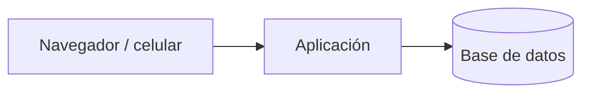

# Validación con usuarios y entrega final

> **Instrucciones:** llena todas las secciones. No elimines ninguna, aunque alguna te parezca breve. Borra los textos entre corchetes y los recuadros de instrucciones antes de entregar. Este archivo se sube a Canvas con el nombre `04-validacion-entrega-final_[NombreDelProyecto]_[TuApellido].md`.

---

## 1. Encabezado

| Dato | Valor |
|---|---|
| **Proyecto** | [nombre del proyecto] |
| **Equipo** | [número y nombre del equipo] |
| **Integrante que entrega** | [tu nombre completo] |
| **Integrantes del equipo** | [lista completa] |
| **URL del sistema final** | [URL desplegada] |
| **Repositorio** | [link; debe ser accesible para el docente] |
| **Versión final del sistema** | [ej. v2.0] |
| **Versión final del contrato técnico** | [ej. v1.3] |
| **Fecha de entrega** | [fecha] |

**Cuentas ficticias para evaluación** (usa solo datos ficticios; no pongas contraseñas reales ni de otros servicios):

| Rol | Usuario | Contraseña |
|---|---|---|
| [rol 1] | | |
| [rol 2] | | |

---

## 2. Validación con usuarios

>  Usa alias ("Usuario A"); **no incluyas datos personales**.

### 2.1 Participantes

| Usuario | Perfil / rol que representa | Experiencia previa con sistemas similares | Fecha de la prueba |
|---|---|---|---|
| Usuario A | | | |


**Justificación de los perfiles elegidos:** [por qué son representativos; si no hay un usuario del perfil real, explica por qué]

### 2.2 Tareas abiertas

> Tareas sin guiar al usuario, ej.: "regístrate y crea un pedido". Observa dónde se traba y **no lo ayudes**.

| Tarea asignada | Usuario | ¿Completó sin ayuda? (Sí / No / Con ayuda) | Tiempo aprox. | Dónde se trabó o qué le confundió |
|---|---|---|---|---|
| | | | | |
| | | | | |
| | | | | |

### 2.3 Recorrido de criterios de aceptación

> Al menos **3 criterios Given/When/Then** de tu contrato, ejecutados por o con un usuario.

| Criterio (ID y escenario) | Resultado (✅ Pasa / ❌ Falla) | Evidencia (captura, nota, observación) |
|---|---|---|
| | | |
| | | |
| | | |

### 2.4 Comentarios espontáneos
- [Usuario A] ...
- [Usuario B] ...

---

## 3. Hallazgos consolidados

| # | Hallazgo | Tipo (bug / usabilidad / requisito mal interpretado / requisito faltante) | Severidad (alta / media / baja) | ¿Se corrigió? (Sí / No / Parcial) |
|---|---|---|---|---|
| 1 | | | | |
| 2 | | | | |
| 3 | | | | |
| 4 | | | | |
| 5 | | | | |

---

## 4. Los 5 cambios implementados

> **2 cambios del cliente** (las propuestas que el docente envió como retroalimentación) y **3 correcciones derivadas de la validación**. Si una propuesta del cliente resultó inviable en el tiempo disponible, puedes sustituirla por un cambio derivado de la validación **solo con aprobación previa del docente** (indica cuándo y cómo se aprobó).
>
> Si modificas un criterio de aceptación o una regla de negocio, **actualiza el contrato** y registra la nueva versión en su historial.

### Cambio 1: [título]
- **Origen:** [Cliente / Validación — hallazgo #X]
- **Requisito o regla afectada:** [RF-XX / RNF-XX / regla de negocio; si es nuevo, el ID nuevo]
- **Cambio en el contrato:** [qué criterios o decisiones se agregaron o modificaron; versión del contrato en que quedó]
- **Cambio en el código:** [módulo, archivos o pantallas afectadas]
- **Criterios de aceptación (Given/When/Then):**
  ```
  Dado ...
  Cuando ...
  Entonces ...
  ```
- **Verificación:** [cómo se comprobó que funciona; qué pruebas se ejecutaron]

### Cambio 2: [título]
[mismo formato]


---

## 5. Trazabilidad final

> La misma tabla de la Etapa 3, con el estado final de **cada** requisito, incluidos los RF nuevos que agregaron los cambios de la sección 4.

| Requisito | Criterio(s) de aceptación | Implementado en (módulo / archivo / pantalla) | Estado final | Evidencia |
|---|---|---|---|---|
| RF-01 | | | ✅ / ⚠️ / ❌ | |
| RF-02 | | | | |
| RF-NN (nuevo) | | | | |

**Resumen:**
- Total de requisitos funcionales: [N]
- Cumplidos: [N] · Parciales: [N] · No cumplidos: [N]

**Requisitos no funcionales:**

| RNF | ¿Cómo se verificó? | Estado final |
|---|---|---|
| RNF-01 | | |
| RNF-02 | | |

---

## 6. Documentación final (SSOT)

> Esta sección, junto con el contrato técnico y el código, es la única fuente de verdad del proyecto. Si algo cambió, queda aquí.

### 6.1 Descripción general
[2 a 3 líneas: qué hace el sistema final y para quién.]

### 6.2 Arquitectura
[Diagrama de arquitectura. Puede ser un bloque Mermaid.]



### 6.3 Stack tecnológico

| Capa | Tecnología | Versión |
|---|---|---|
| Frontend | | |
| Backend / API | | |
| Base de datos | | |
| Hosting | | |

### 6.4 Cómo ejecutarlo localmente

```bash
# pasos de instalación y ejecución
```

> No incluyas contraseñas ni claves reales. Indica cómo configurar las variables privadas (por ejemplo, con un archivo de ejemplo sin valores reales).

### 6.5 Decisiones de arquitectura vigentes

| Decisión | Estado (sin cambios / modificada) | Si cambió: qué cambió y por qué |
|---|---|---|
| [ej. Base de datos] | | |
| [ej. Autenticación] | | |

### 6.6 Changelog

| Versión | Fecha | Cambios |
|---|---|---|
| v1.0 (MVP) | | Versión inicial según el contrato v[X] |
| v[final] | | [resumen de los 5 cambios] |

**Historial de versiones del contrato técnico** (resumen; el detalle está en el contrato):

| Versión | Fecha | Qué cambió | Motivo |
|---|---|---|---|
| | | | |

### 6.7 Pendientes conocidos y trabajo futuro
- [ ] [Hallazgos que no se alcanzaron a corregir]
- [ ] [Mejoras identificadas]

---

## 7. Uso de IA y reflexión

### 7.1 Uso de IA en esta etapa

| Agente / herramienta | Para qué se usó | Qué tuvo que corregirse manualmente |
|---|---|---|
| | | |
| | | |

> Sé específico: no basta con "usamos IA para todo". Indica qué tareas concretas hizo el agente y qué errores o malas decisiones tuviste que corregir.

### 7.2 Reflexión
[3 a 5 líneas: qué hizo bien la IA, qué hizo mal, qué decisiones tuvo que tomar el equipo por criterio propio y qué harían distinto.]

---

## Lista de verificación antes de entregar

- [ ] El sistema está accesible en la URL indicada.
- [ ] Las cuentas ficticias de la sección 1 funcionan.
- [ ] No hay contraseñas, claves ni credenciales reales en este archivo ni en el repositorio.
- [ ] Las 5 secciones de cambios están completas y verificadas en el sistema desplegado.
- [ ] El contrato técnico del repositorio está en su versión final.
- [ ] La trazabilidad coincide con lo que se ve en el sistema.
- [ ] Puedo explicar cualquier parte del sistema y de este documento.
- [ ] Después de la evaluación cambiaré o eliminaré las cuentas de demostración.
