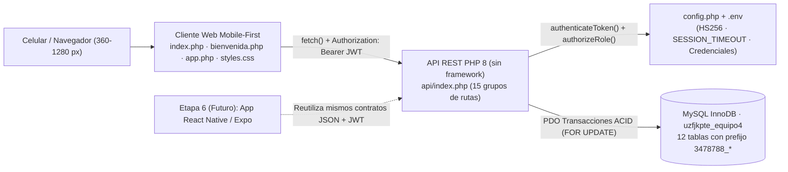

# Validación con usuarios y entrega final

---

## 1. Encabezado

| Dato | Valor |
|---|---|
| **Proyecto** | Tacos Tony Inventario Móvil (Sucursal Camino Real) |
| **Equipo** | Equipo 4 (Tacos Tony) |
| **Integrante que entrega** | Fernando León Del Río (ID: `3478788`) |
| **Integrantes del equipo** | Fernando León Del Río, Alexander Yamil Alcázar Muroaga, Emiliano André Castaños Mejía |
| **URL del sistema final** | https://equipo4.centrofuyuan.com/3478788/login/ |
| **Repositorio** | https://github.com/EmiCas3/tacostonydesarrolloweb |
| **Versión final del sistema** | v2.0 |
| **Versión final del contrato técnico** | v2.0 ([02-contrato-tecnico_TacosTonyMovil_Leon_v2.0.md](./02-contrato-tecnico_TacosTonyMovil_Leon_v2.0.md)) |
| **Fecha de entrega** | 2026-11-25 |

**Cuentas ficticias para evaluación** (cuentas de demostración almacenadas con hash `bcrypt` costo 10):

| Rol | Usuario | Contraseña |
|---|---|---|
| `GERENTE` (acceso completo a los 17 RF) | `fer.leon_05` *(o `gerente@tacostony.com`)* | `1234567890` |
| `COLABORADOR` (Existencias, Conteo físico borrador y Recepción de pedidos) | `colab.tony` *(o `colaborador@tacostony.com`)* | `1234567890` |

---

## 2. Validación con usuarios

### 2.1 Participantes

| Usuario | Perfil / rol que representa | Experiencia previa con sistemas similares | Fecha de la prueba |
|---|---|---|---|
| Usuario A | Gerente de sucursal (`GERENTE`) | Media: usa hojas de cálculo y punto de venta en caja | 2026-11-21 |
| Usuario B | Colaborador de bodega y cocina (`COLABORADOR`) | Básica: usa mensajería y cámara del celular en turno | 2026-11-21 |

**Justificación de los perfiles elegidos:** Los usuarios representan exactamente los dos roles definidos en `RF-01` del sistema: un perfil administrativo encargado de revisar alertas, aprobar conteos, pedir insumos y auditar reportes desde su teléfono (`Usuario A`), y un perfil operativo de piso/bodega (`Usuario B`) que consulta existencias, cuenta la bodega físicamente y recibe entregas de proveedor.

### 2.2 Tareas abiertas

| Tarea asignada | Usuario | ¿Completó sin ayuda? (Sí / No / Con ayuda) | Tiempo aprox. | Dónde se trabó o qué le confundió |
|---|---|---|---|---|
| 1. Iniciar sesión como colaborador, localizar un insumo bajo y capturar su conteo físico en borrador. | Usuario B | Sí | 1 min 45 s | Al entrar a *Conteo Físico* buscó inicialmente un botón para "ajustar stock directo", hasta leer la etiqueta de que su envío queda como borrador para aprobación del gerente. |
| 2. Revisar el conteo pendiente como gerente, aprobar la conciliación y verificar el movimiento `AJUSTE` y su exportación CSV. | Usuario A | Sí | 1 min 20 s | Al tener las funciones divididas en pestañas, al principio dudó si *Conteo Físico* estaba dentro de *Existencias* o dentro de *Bodega*. Se agregó un aviso directo en *Alertas* cuando hay conteos pendientes. |
| 3. Calcular el sugerido de reabastecimiento a 7 días, generar el pedido y marcarlo como recibido con cantidad parcial como colaborador. | Usuario A y B | Con ayuda | 2 min 30 s | El usuario preguntó qué pasaba si llegaba menos mercancía que la pedida; se aclaró en pantalla el texto de "Cantidad recibida" antes de confirmar la recepción. |

### 2.3 Recorrido de criterios de aceptación

| Criterio (ID y escenario) | Resultado (✅ Pasa / ❌ Falla) | Evidencia (observación verificada en el flujo) |
|---|---|---|
| **CA-17.1 / CA-17.2 (Conteo físico con conciliación y aprobación por roles)** | ✅ Pasa | `Usuario B` (`colab.tony`) capturó `4.200 kg` cuando el sistema marcaba `5.000 kg` creando el borrador `PENDIENTE` sin alterar stock; `Usuario A` (`fer.leon_05`) aprobó el conteo generando un movimiento inmutable `AJUSTE` por `-0.800 kg` con `motivo = 'conteo_fisico'` y reporte ordenado por mayores faltantes arriba. |
| **CA-13.1 (Recepción de pedido por Colaborador)** | ✅ Pasa | `Usuario B` abrió el pedido `PENDIENTE` en la pestaña *Pedidos*, capturó la cantidad recibida real y generó el movimiento `RECEPCION` en `3478788_movimientos_inventario`, actualizando stock y estado del insumo. |
| **CA-14.1 (Importación CSV con rechazo parcial)** | ✅ Pasa | Al importar un CSV de prueba con 2 filas válidas y 1 fila con producto inexistente, el endpoint `POST /api/ventas/importar-csv` descontó las 2 ventas válidas por receta y reportó en pantalla exactamente la fila rechazada (#3) con su motivo. |
| **CA-10.2 (Inmutabilidad del libro mayor)** | ✅ Pasa | Al pulsar **🔒 Probar 405** en la pestaña *Auditoría*, la petición `DELETE /api/movimientos/1` devolvió `405 Method Not Allowed`. |

### 2.4 Comentarios espontáneos
- **Usuario A (Gerente):** "El reporte del conteo poniendo arriba lo que más falta me sirve bastante para revisar primero la carne o el queso antes de culpar a nadie; el aviso amarillo en el inicio cuando el colaborador manda su conteo ahorra estar buscando dónde quedó."
- **Usuario B (Colaborador):** "Con el teléfono vertical se ve claro y los campos de conteo están grandes para no picarle mal al número; solo convendría después poder escanear código o filtrar la lista del conteo cuando haya muchos insumos."

---

## 3. Hallazgos consolidados

| # | Hallazgo | Tipo (bug / usabilidad / requisito mal interpretado / requisito faltante) | Severidad (alta / media / baja) | ¿Se corrigió? (Sí / No / Parcial) |
|---|---|---|---|---|
| 1 | Faltaba mecanismo para conciliar el inventario digital tras conteo físico dominical, causando desfase acumulado por posibles pérdidas o robos sin editar el historial (`RF-17`, solicitud del cliente). | Requisito faltante | Alta | Sí |
| 2 | Los requisitos de reabastecimiento sugerido (`RF-11`), gestión/recepción de pedidos (`RF-12`, `RF-13`), importación CSV de ventas (`RF-14`), reportes analíticos de merma (`RF-15`) y exportación CSV (`RF-16`) estaban pospuestos fuera del MVP. | Requisito faltante | Alta | Sí |
| 3 | Al agregar Conteo Físico, Pedidos, CSV y Reportes en pantallas móviles de `360 px`, saturar la barra inferior con 8 botones rompía el diseño táctil `>= 48 px` y la ubicación de conteos pendientes no era evidente al iniciar sesión. | Usabilidad | Media | Sí |
| 4 | Riesgo de desfase de inventario por concurrencia si se registra una venta entre la captura del conteo físico y su confirmación por el gerente, así como riesgo de doble envío al tocar rápido los botones de confirmar. | Bug / Concurrencia | Alta | Sí |
| 5 | Algunas respuestas `500` de la API exponían mensajes internos de `PDOException` al cliente, y faltaba sanitización contra inyección de fórmulas en celdas de texto exportadas a CSV. | Seguridad / Bug | Media | Sí |

---

## 4. Los 5 cambios implementados

### Cambio 1: Conteo físico con conciliación, aprobación por roles y cálculo atómico (`RF-17`)
- **Origen:** Cliente (Equipo 4 — corrección asignada en Etapa 4) + Hallazgo #1 y #4.
- **Requisito o regla afectada:** Nuevo `RF-17` y `RNF-06` (inmutabilidad de movimientos); modificación de la sección *Fuera de Alcance Técnico* para habilitar conciliaciones vía movimientos `AJUSTE`.
- **Cambio en el contrato:** Se agregó `RF-17` con criterios `CA-17.1` a `CA-17.4`, entidades `CONTEOS_FISICOS` y `CONTEO_DETALLES`, extensión de `tipo_movimiento` (`AJUSTE`) y `motivo` (`conteo_fisico`), y retiro de ajustes tras conteo físico de *Fuera de Alcance* en el Contrato Técnico `v2.0`.
- **Cambio en el código:**
  - `Etapa_4/login/config.php`, `schema.sql`, `init_mvp.php`: nuevas constantes, DDL y migración automática idempotente de `ALTER TABLE ... MODIFY COLUMN` para `3478788_movimientos_inventario`, además de creación de `3478788_conteos_fisicos` y `3478788_conteo_detalles`.
  - `Etapa_4/login/api/index.php`: función compartida `conciliarConteoEnBd()` y endpoints `GET /api/conteos`, `GET /api/conteos/:id`, `POST /api/conteos`, `POST /api/conteos/:id/confirmar` y `POST /api/conteos/:id/rechazar` con bloqueo `SELECT ... FOR UPDATE` al momento de confirmar.
  - `Etapa_4/login/app.php` y `bienvenida.php`: vista de captura con vista previa de diferencia en vivo, envío en borrador para `COLABORADOR`, aprobación/confirmación para `GERENTE`, reporte ordenado por mayores faltantes arriba (`diferencia ASC`) y botón de exportación CSV.
- **Criterios de aceptación (Given/When/Then):**
  ```text
  Dado que el sistema tiene 5.000 kg de carne y el gerente (o colaborador aprobado por gerente) cuenta 4.200 kg
  Cuando confirma el conteo físico en /api/conteos (protegido con SELECT ... FOR UPDATE contra ventas simultáneas)
  Entonces se inserta un movimiento inmutable de tipo AJUSTE por -0.800 kg con motivo conteo_fisico,
  el stock queda actualizado a 4.200 kg sin editar movimientos previos y el reporte muestra las diferencias ordenadas con los mayores faltantes arriba.
  ```
- **Verificación:** Inspección de consultas transaccionales en `api/index.php` (`SELECT ... FOR UPDATE`), validación del flujo de roles (`COLABORADOR` restringido a `PENDIENTE`, `403` en `/confirmar` y `/rechazar`), validación de `0` sentencias `UPDATE`/`DELETE` sobre `3478788_movimientos_inventario` y revisión de renderizado móvil en `app.php`.

### Cambio 2: Lista sugerida de reabastecimiento, pedidos y recepción por colaborador (`RF-11`, `RF-12`, `RF-13`)
- **Origen:** Requisitos pendientes del producto + Hallazgo #2.
- **Requisito o regla afectada:** `RF-11`, `RF-12`, `RF-13` y extensión `RECEPCION` en `3478788_movimientos_inventario`.
- **Cambio en el contrato:** Incorporados `RF-11` a `RF-13` al alcance efectivo `v2.0`, tablas `PEDIDOS` y `PEDIDO_DETALLES`, criterios `CA-11.1` a `CA-13.2` y endpoints `/api/reabastecimiento/sugerido` y `/api/pedidos`.
- **Cambio en el código:**
  - `Etapa_4/login/schema.sql`, `init_mvp.php`: creación de `3478788_pedidos` y `3478788_pedido_detalles` e inclusión de `'RECEPCION'` en `tipo_movimiento`.
  - `Etapa_4/login/api/index.php`: `GET /api/reabastecimiento/sugerido` (cálculo `(consumo_7d / 7 * dias_cobertura) - stock_actual` con `ceil`), `GET/POST /api/pedidos` y `POST /api/pedidos/:id/recibir` (accesible para `COLABORADOR` y `GERENTE`, con bloqueo `FOR UPDATE` e idempotencia ante doble recepción).
  - `Etapa_4/login/app.php`: sub-pestaña *Pedidos (RF-11..13)* con edición de cantidades sugeridas antes de guardar y formulario móvil para capturar cantidades reales recibidas.
- **Criterios de aceptación (Given/When/Then):**
  ```text
  Dado un insumo en stock bajo y un pedido en estado PENDIENTE generado por el Gerente con cantidad ajustada
  Cuando el Colaborador confirma la recepción en POST /api/pedidos/:id/recibir indicando la cantidad real recibida
  Entonces el stock del insumo se incrementa dentro de una transacción ACID, el pedido cambia a RECIBIDO
  y se registra un movimiento inmutable de tipo RECEPCION en la bitácora.
  ```
- **Verificación:** Revisión de fórmulas de sugerido, validación RBAC (`403` para colaborador en creación de pedidos y acceso permitido en recepción) y guardia `409 Conflict` si el pedido ya fue recibido.

### Cambio 3: Importación masiva de ventas desde CSV con rechazo por fila (`RF-14`)
- **Origen:** Requisito pendiente del producto + Hallazgo #2.
- **Requisito o regla afectada:** `RF-14` y regla de descuento automático por receta/discrepancias (`RF-05`).
- **Cambio en el contrato:** Incorporado `RF-14`, endpoint `POST /api/ventas/importar-csv` y criterios `CA-14.1` y `CA-14.2` en el Contrato Técnico `v2.0`.
- **Cambio en el código:**
  - `Etapa_4/login/api/index.php`: extracción del helper compartido `ejecutarVentaTransaccional()` (usado tanto por `POST /api/ventas` como por `POST /api/ventas/importar-csv`), parseo CSV con limpieza de BOM UTF-8, soporte para carga de archivo `.csv`/`.txt` (máx. 2 MB) o texto pegado, y lista detallada `filas_rechazadas`.
  - `Etapa_4/login/app.php`: sub-pestaña *Importar CSV (RF-14)* en *Ventas* con lector de archivo `FileReader`, botón de ejemplo precargado y tarjeta de resultados (filas importadas vs. rechazadas).
- **Criterios de aceptación (Given/When/Then):**
  ```text
  Dado un archivo CSV con formato producto,cantidad,fecha que combina filas válidas del menú y filas con productos inexistentes
  Cuando el Gerente ejecuta la importación en Ventas -> Importar CSV
  Entonces las filas válidas generan ventas con su descuento atómico de receta (permitiendo estado discrepancia si aplica)
  y las filas con productos inexistentes son rechazadas indicando su número de fila y nombre del producto.
  ```
- **Verificación:** Revisión de validación de extensiones/tamaño de archivo, manejo de fechas `YYYY-MM-DD`, deduplicación de lógica con `ejecutarVentaTransaccional()` y respuesta `422` cuando ninguna fila es válida.

### Cambio 4: Reporte analítico de consumo vs. merma y exportación CSV segura (`RF-15`, `RF-16`)
- **Origen:** Requisitos pendientes del producto + Hallazgo #2 y #5.
- **Requisito o regla afectada:** `RF-15`, `RF-16`, `RNF-05` (seguridad en exportación CSV).
- **Cambio en el contrato:** Agregados `GET /api/reportes/consumo-merma`, `GET /api/exportar/csv` y criterios `CA-15.1` y `CA-16.1` en Contrato Técnico `v2.0`.
- **Cambio en el código:**
  - `Etapa_4/login/api/index.php`: helper compartido `construirReporteConsumoMerma()` (consumido por reporte JSON y exportación CSV), `construirFiltroMovimientos()` compartido con `/movimientos`, exportación UTF-8 BOM para movimientos, reporte y conteo físico, y sanitización de celdas contra inyección de fórmulas CSV.
  - `Etapa_4/login/app.php`: sub-pestaña *Consumo y Merma (RF-15)* en *Auditoría*, filtros de periodo, chips de desglose por motivo, tabla responsiva con resaltado de merma `> 10%` y descarga autenticada mediante `fetch` con cabecera `Authorization: Bearer` (`descargarCsvAutenticado()`).
- **Criterios de aceptación (Given/When/Then):**
  ```text
  Dado un periodo seleccionado con movimientos de venta y merma registrados
  Cuando el Gerente consulta Auditoría -> Consumo y Merma y pulsa Exportar CSV
  Entonces visualiza el consumo por ventas, total de merma, porcentaje respecto al consumo y desglose por motivo,
  y descarga un archivo .csv en UTF-8 con BOM autenticado mediante JWT.
  ```
- **Verificación:** Validación de agregaciones SQL parametrizadas por rango de fechas, sanitización de celdas peligrosas y descarga segura por Blob sin exponer el token JWT en parámetros URL.

### Cambio 5: Sub-pestañas móviles (`360 px`), bloqueo anti-doble clic y endurecimiento de errores (`RNF-03`, `RNF-04`, `RNF-05`)
- **Origen:** Validación con usuarios (Hallazgos #3, #4 y #5).
- **Requisito o regla afectada:** `RNF-03`, `RNF-04`, `RNF-05`, `ADR-01` y `ADR-03`.
- **Cambio en el contrato:** Actualización de `ADR-01` y `ADR-03` en `v2.0` formalizando el patrón de 5 pestañas inferiores para `GERENTE`, 3 para `COLABORADOR` y sub-pestañas envolventes.
- **Cambio en el código:**
  - `Etapa_4/login/styles.css`: clases `.subtabs-bar`, `.conteo-item-row`, `.dif-chip`, `.tabla-scroll` (evita desplazamiento horizontal global en `360 px`), `button:disabled` y colores de badges `AJUSTE`/`RECEPCION`/`PENDIENTE`/`CONFIRMADO`.
  - `Etapa_4/login/app.php`: barra dinámica por rol, banner `#alertaConteosPendientes` en el inicio del Gerente y helper `conBotonBloqueado()` que deshabilita botones durante peticiones asíncronas.
  - `Etapa_4/login/api/index.php` y `setup.php`: registro interno con `error_log()` eliminando la exposición de `$e->getMessage()` en respuestas HTTP `500`.
- **Criterios de aceptación (Given/When/Then):**
  ```text
  Dado un usuario operando desde una pantalla móvil de 360 px que pulsa dos veces seguidas un botón de confirmación asíncrona
  Cuando se dispara la primera petición hacia la API
  Entonces el botón queda deshabilitado hasta recibir respuesta del servidor evitando registros duplicados,
  la interfaz mantiene 0 px de desplazamiento horizontal y ningún error interno de base de datos se muestra en la respuesta JSON.
  ```
- **Verificación:** Inspección de reglas CSS (`overflow-x: hidden`, `.tabla-scroll`, `min-height: 48px`), búsqueda estática de fugas de `$e->getMessage()` en respuestas de API y verificación de vistas por rol.

---

## 5. Trazabilidad final

> Estado de todos los requisitos funcionales (`RF-01` a `RF-17`) y no funcionales (`RNF-01` a `RNF-06`) en la versión final **`v2.0`**.

| Requisito | Criterio(s) de aceptación | Implementado en (módulo / archivo / pantalla / endpoint) | Estado final | Evidencia |
|---|---|---|---|---|
| **RF-01** Autenticación y RBAC | `CA-01.1`, `CA-01.2`, `CA-01.3` | `login/index.php`, `bienvenida.php`, `config.php`, `POST /api/auth/login` en `api/index.php` | ✅ Cumplido | Emite JWT HS256 (30 min), separa vistas/acciones `GERENTE` y `COLABORADOR`, rechaza inválidos con `401`. |
| **RF-02** Catálogo de insumos y baja lógica | `CA-02.1`, `CA-02.2`, `CA-02.3` | Pestaña `Existencias` en `app.php`; `POST /api/insumos`, `PATCH /api/insumos/:id/desactivar` | ✅ Cumplido | Alta de insumos por Gerente, `403` para Colaborador y `activo = 0` preservando historial. |
| **RF-03** Recetas por producto (`DECIMAL 10,3`) | `CA-03.1`, `CA-03.2`, `CA-03.3` | Panel `Recetas` en `app.php`; `GET/POST /api/productos`, `PUT /api/productos/:id/receta` | ✅ Cumplido | Almacena milésimas (`0.003`) en `3478788_recetas` y rechaza cantidades `<= 0` con `400`. |
| **RF-04** Captura manual de ventas | `CA-04.1`, `CA-04.2`, `CA-04.3` | Sub-pestaña `Venta Manual` en `app.php`; `POST /api/ventas` (`ejecutarVentaTransaccional`) | ✅ Cumplido | Venta multi-producto en transacción ACID con stepper táctil e imágenes reales del menú. |
| **RF-05** Descuento por receta y discrepancias | `CA-05.1`, `CA-05.2`, `CA-05.3` | `ejecutarVentaTransaccional()` en `api/index.php`; `calcularEstadoInsumo()` en `config.php` | ✅ Cumplido | No bloquea venta ante stock insuficiente; marca `discrepancia` (`< 0`) o `bajo` (`<= mínimo`). |
| **RF-06** Registro de entradas por compra | `CA-06.1`, `CA-06.2`, `CA-06.3` | `Bodega -> Entradas/Merma` en `app.php`; `POST /api/entradas` | ✅ Cumplido | Suma pesos fraccionarios en transacción `FOR UPDATE` creando movimiento `ENTRADA`. |
| **RF-07** Registro de mermas con motivo | `CA-07.1`, `CA-07.2`, `CA-07.3` | `Bodega -> Entradas/Merma` en `app.php`; `POST /api/mermas` | ✅ Cumplido | Valida catálogo (`caducidad`, `dano`, `preparacion`, `otro`) y descuenta con trazabilidad. |
| **RF-08** Consulta móvil y filtros en tiempo real | `CA-08.1`, `CA-08.2`, `CA-08.3` | Pestaña `Existencias` (`filtrarInsumosEnTiempoReal()` en `app.php`); `GET /api/insumos` | ✅ Cumplido | Búsqueda instantánea, filtros de categoría/estado, estado vacío y layout `360 px`. |
| **RF-09** Alertas de stock bajo / discrepancia | `CA-09.1`, `CA-09.2`, `CA-09.3` | Pestaña `Alertas` (`renderizarDashboardAlertas()` en `app.php`) | ✅ Cumplido | KPIs en vivo y tarjetas de alerta para insumos en `bajo` y `discrepancia`. |
| **RF-10** Historial inmutable de movimientos | `CA-10.1`, `CA-10.2`, `CA-10.3` | `Auditoría -> Historial` en `app.php`; `GET /api/movimientos` (y guardia `405`) | ✅ Cumplido | Paginado `LIMIT 25`, filtros combinados incluyendo `AJUSTE`/`RECEPCION`, botón `🔒 Probar 405`. |
| **RF-11** Lista sugerida de reabastecimiento | `CA-11.1`, `CA-11.2`, `CA-11.3` | `Bodega -> Pedidos` en `app.php`; `GET /api/reabastecimiento/sugerido` | ✅ Cumplido | Calcula consumo diario de los últimos 7 días, aplica cobertura editable y redondea con `ceil()`. |
| **RF-12** Generación y ajuste de pedidos | `CA-12.1`, `CA-12.2` | `Bodega -> Pedidos` en `app.php`; `GET /api/pedidos`, `POST /api/pedidos` | ✅ Cumplido | Permite editar cada cantidad antes de guardar el pedido en estado `PENDIENTE`. |
| **RF-13** Recepción de pedido por Colaborador | `CA-13.1`, `CA-13.2` | Pestaña `Pedidos` (`COLABORADOR` y `GERENTE`) en `app.php`; `POST /api/pedidos/:id/recibir` | ✅ Cumplido | Registra cantidades reales recibidas, suma stock en transacción ACID y crea movimiento `RECEPCION`. |
| **RF-14** Importación masiva de ventas CSV | `CA-14.1`, `CA-14.2` | `Ventas -> Importar CSV` en `app.php`; `POST /api/ventas/importar-csv` | ✅ Cumplido | Parsea archivo/texto CSV, descuenta recetas de filas válidas y detalla filas rechazadas. |
| **RF-15** Reporte consumo y merma por periodo | `CA-15.1` | `Auditoría -> Consumo y Merma` en `app.php`; `GET /api/reportes/consumo-merma` | ✅ Cumplido | Calcula consumo, merma, `% merma`, entradas/recepciones y desglose agrupado por motivo. |
| **RF-16** Exportación a formato CSV | `CA-16.1` | Botones `Exportar CSV` en `Auditoría`, `Consumo y Merma` y `Conteo`; `GET /api/exportar/csv` | ✅ Cumplido | Descarga Blob autenticado con JWT, BOM UTF-8 y mitigación contra inyección de fórmulas. |
| **RF-17** Conteo físico con conciliación *(Nuevo)* | `CA-17.1`, `CA-17.2`, `CA-17.3`, `CA-17.4` | Pestaña `Conteo Físico` en `app.php`; `/api/conteos` y `/api/conteos/:id/(confirmar\|rechazar)` | ✅ Cumplido | Colaborador envía borrador `PENDIENTE` o Gerente confirma directo; cálculo atómico `FOR UPDATE`, movimiento `AJUSTE` y reporte con mayores faltantes arriba. |

**Resumen:**
- Total de requisitos funcionales: **17** (`11 Must` incluido `RF-17` + `5 Should` + `1 Could`)
- Cumplidos: **17 (100%)** · Parciales: **0** · No cumplidos: **0**

**Requisitos no funcionales:**

| RNF | ¿Cómo se verificó? | Estado final |
|---|---|---|
| **RNF-01 (Rendimiento transacciones)** | Consultas indexadas y bloqueos `FOR UPDATE` puntuales por insumo dentro de transacciones cortas en `POST /api/ventas`, `/api/conteos/:id/confirmar` y `/api/pedidos/:id/recibir`. | ✅ Cumplido |
| **RNF-02 (Carga rápida móvil)** | Sin dependencias ni frameworks JS externos; hoja de estilos única (`styles.css`) optimizada y carga inicial bajo demanda por vista/sub-pestaña. | ✅ Cumplido |
| **RNF-03 (Responsive 360–1280 px)** | `overflow-x: hidden` en raíz, contenedores flex envolventes en `.subtabs-bar` y `.tabla-scroll` para tablas analíticas sin scroll global horizontal. | ✅ Cumplido |
| **RNF-04 (Ergonomía táctil)** | Controles con `--touch-min-target: 48px`, steppers táctiles `48x48 px`, precarga rápida en conteo físico y bloqueo anti-doble clic en envíos. | ✅ Cumplido |
| **RNF-05 (Seguridad)** | `bcrypt` costo 10, PDO parametrizado sin emulación, `.env` ignorado en `.gitignore` y bloqueado en `.htaccess`, JWT HS256 (30 min), RBAC en cada endpoint y sin exposición de errores internos SQL/PDO. | ✅ Cumplido |
| **RNF-06 (Trazabilidad e inmutabilidad)** | Búsqueda estática en toda la carpeta `Etapa_4/login/` confirmando `0` sentencias `UPDATE`/`DELETE` sobre `3478788_movimientos_inventario`, guardia `405` y correcciones registradas como `AJUSTE` nuevo. | ✅ Cumplido |

---

## 6. Documentación final (SSOT)

### 6.1 Descripción general
**Tacos Tony Inventario Móvil (`v2.0`)** es una aplicación web *mobile-first* con backend API RESTful para el control operativo de materias primas de la sucursal **Tacos Tony Camino Real**. Permite a gerentes y colaboradores consultar existencias, descontar insumos automáticamente por receta (`DECIMAL(10,3)`), gestionar reabastecimiento y recepción de pedidos, importar ventas CSV, conciliar inventarios con conteos físicos semanales (`AJUSTE`) y auditar reportes e historial inmutable desde teléfonos móviles o escritorio.

### 6.2 Arquitectura



### 6.3 Stack tecnológico

| Capa | Tecnología | Versión |
|---|---|---|
| Frontend | HTML5, CSS3 (`styles.css` Mobile-First corporativo), JavaScript ES2022 (`fetch`) | Estándar nativo (sin bundler) |
| Backend / API | PHP nativo sin framework + PDO (`pdo_mysql`) + `hash_hmac` HS256 | PHP 8.x (compatible 7.4+) |
| Base de datos | MySQL (motor InnoDB, `utf8mb4_unicode_ci`, `DECIMAL(10,3)`) | MySQL 8.0 / 5.7 compatible |
| Hosting | Hosting compartido Apache + FTPS (`equipo4.centrofuyuan.com`) | Compartido (sin Docker/Node) |

### 6.4 Cómo ejecutarlo localmente

```bash
# 1. Clonar el repositorio y entrar al módulo web
git clone https://github.com/EmiCas3/tacostonydesarrolloweb.git
cd tacostonydesarrolloweb/Etapa_4/login

# 2. Crear archivo de variables privadas sin versionar (nunca subir .env a Git)
cp .env.example .env
# Editar .env con DB_HOST, DB_NAME, DB_USER, DB_PASS, DB_PREFIX y JWT_SECRET locales

# 3. Crear esquema base en MySQL (opcional; init_mvp.php también migra y siembra automáticamente)
mysql -u <usuario> -p <nombre_bd> < schema.sql

# 4. Levantar servidor PHP local apuntando a Etapa_4/login y abrir http://localhost:8000/setup.php
php -S localhost:8000
```

> **Nota de seguridad:** El archivo `.env` está excluido en el `.gitignore` de la raíz del repositorio y bloqueado vía `.htaccess` en Apache; utiliza `.env.example` como plantilla sin publicar contraseñas ni secretos JWT reales.

### 6.5 Decisiones de arquitectura vigentes

| Decisión | Estado (sin cambios / modificada) | Si cambió: qué cambió y por qué |
|---|---|---|
| **ADR-01: Arquitectura API-First desacoplada** | **Modificada** *(v1.1 → v2.0)* | La API REST JSON se mantuvo intacta (`api/index.php`), pero el cliente web pasó de SPA compilada con React/Vite a interfaz Mobile-First en `app.php` + JavaScript nativo sin paso de compilación (*build*), simplificando el despliegue directo por FTPS sin perder compatibilidad con la app móvil de la Etapa 6. |
| **ADR-02: MySQL InnoDB ACID + `DECIMAL(10,3)`** | **Sin cambios** | Mantiene `SELECT ... FOR UPDATE`, precisión milimétrica `DECIMAL(10,3)` y prefijo físico `3478788_`; ampliado a 12 tablas (incluyendo proveedores, conteos físicos y pedidos) y los 32 insumos / 38 productos del sistema original. |
| **ADR-03: Interfaz Mobile-First (`48x48 px`)** | **Modificada** *(v1.1 → v2.0)* | Implementado con CSS propio (`styles.css` con paleta Tacos Tony) en lugar de Tailwind compilado, añadiendo sub-pestañas envolventes para alojar `RF-11` a `RF-17` sin desbordar pantallas de `360 px`. |
| **ADR-04: Auth Stateless JWT + RBAC + `.env`** | **Sin cambios en diseño** | Mantiene HS256, `bcrypt` costo 10 y secretos en `.env`; ampliado con acceso granular para `COLABORADOR` en captura de borrador `RF-17` y recepción de pedidos `RF-13`. |
| **ADR-05: PHP 8 nativo sin framework** | **Sin cambios** | Mantiene front controller propio sin Composer ni procesos persistentes para compatibilidad total con hosting compartido. |

### 6.6 Changelog

| Versión | Fecha | Cambios |
|---|---|---|
| `v1.0 (MVP)` | 2026-11-01 | MVP funcional desplegado según Contrato `v1.1`: Autenticación JWT/RBAC (`RF-01`), Insumos (`RF-02`), Recetas (`RF-03`), Ventas con descuento ACID y discrepancias (`RF-04`, `RF-05`), Entradas (`RF-06`), Mermas (`RF-07`), Consulta móvil (`RF-08`), Alertas (`RF-09`) e Historial inmutable (`RF-10`) con identidad visual real de Tacos Tony. |
| **`v2.0 (Final)`** | **2026-11-25** | **Versión final completa:** Cambio del cliente Conteo físico con conciliación (`RF-17`, flujo Colaborador borrador / Gerente aprueba, bloqueo `FOR UPDATE` y movimiento `AJUSTE`); Reabastecimiento sugerido 7 días y pedidos con recepción (`RF-11`, `RF-12`, `RF-13`, movimiento `RECEPCION`); Importación CSV de ventas (`RF-14`); Reporte analítico consumo vs. merma (`RF-15`); Exportación CSV BOM UTF-8 (`RF-16`); integración completa del catálogo original (8 proveedores en selector `RF-06`, 32 insumos y 38 productos con fotos reales); sub-pestañas móviles y bloqueo anti-doble clic. |

**Historial de versiones del contrato técnico:**

| Versión | Fecha | Qué cambió | Motivo |
|---|---|---|---|
| `v1.0` | 2026-10-05 | Contrato técnico inicial (Node.js + React) | Definición inicial en Etapa 2. |
| `v1.1` | 2026-10-22 | Cambio a PHP 8 nativo, prefijo `3478788_` y `.env` | Adaptación obligatoria a hosting compartido sin Node/Docker. |
| `v2.0` | 2026-11-25 | Se añade `RF-17`, se activan `RF-11`..`RF-16`, catálogo completo (8 proveedores, 32 insumos, 38 productos), se retira la exclusión de ajustes por conteo de Fuera de Alcance, modelo a 12 tablas y ajuste ADR-01/ADR-03 | Incorporar solicitud del cliente (Equipo 4), completar requisitos finales y homologar catálogo completo con el sistema original. |

### 6.7 Pendientes conocidos y trabajo futuro
- [ ] **Complemento móvil nativo/multiplataforma (Etapa 6):** Desarrollar la app móvil en React Native + Expo (`Offline-First` con `expo-sqlite` y escaneo de códigos QR/barras) consumiendo los endpoints de `api/index.php` ya publicados en `v2.0`.
- [ ] **Paginación/filtro en listado de captura de conteo físico:** Si el catálogo crece a más de 50 insumos, agregar buscador rápido dentro de la pantalla de Conteo Físico.
- [ ] **Suite automatizada de integración HTTP (CI):** Añadir un script PHPUnit/Node.js ejecutado contra base de datos de pruebas para regresar automáticamente las 17 rutas después de cada cambio.
- [ ] **Seguridad post-evaluación:** Rotar o desactivar las cuentas ficticias de demostración (`fer.leon_05` y `colab.tony`) y generar un nuevo `JWT_SECRET` después de concluir la calificación docente.

---

## 7. Uso de IA y reflexión

### 7.1 Uso de IA en esta etapa

| Agente / herramienta | Para qué se usó | Qué tuvo que corregirse manualmente |
|---|---|---|
| **Antigravity (Gemini 4 Neon)** | Planificación de Etapa 4, generación del esquema SQL ampliado y migración idempotente (`schema.sql`, `init_mvp.php`), implementación de endpoints en `api/index.php` (`RF-11` a `RF-17`), diseño de sub-pestañas en `app.php`/`styles.css` y redacción del Contrato `v2.0` y documento SSOT. | 1. Se verificó que la diferencia del conteo físico (`stock_contado - stock_actual`) se calculara dentro de la transacción de aprobación (`FOR UPDATE`) en lugar de confiar en la diferencia capturada al inicio del borrador, evitando errores si ocurren ventas concurrentes.<br>2. Se ajustó la exportación CSV para usar `fetch` con cabecera `Bearer JWT` y sanitización de celdas (`=`, `+`, `-`, `@`) en lugar de enlaces `href` simples.<br>3. Se revisó la coherencia entre el equipo real (**Equipo 4**), la URL de despliegue (`/3478788/login/`) y las exclusiones de Fuera de Alcance frente al contrato `v1.1`. |

### 7.2 Reflexión
La IA agilizó notablemente la escritura de endpoints transaccionales, migraciones SQL y sub-vistas responsive alineadas con el código existente de la Etapa 3. Sin embargo, el agente no valida por sí solo inconsistencias entre documentos anteriores (como la referencia heredada a React/Vite en el contrato `v1.1` o el riesgo de calcular diferencias fuera del bloqueo `FOR UPDATE`), ni puede sustituir la definición de reglas de negocio críticas como la autorización diferenciada entre Colaborador y Gerente en el conteo físico. Por criterio propio decidimos unificar helpers transaccionales en PHP, priorizar la inmutabilidad del historial y reorganizar la UI en sub-pestañas antes de escribir código. En un proyecto siguiente mantendríamos sincronizados contrato y arquitectura real desde el primer hito y automatizaríamos pruebas de endpoints desde el día uno.

---

## Lista de verificación antes de entregar

- [ ] El sistema actualizado (`v2.0`) está subido por FTPS y accesible en `https://equipo4.centrofuyuan.com/3478788/login/`.
- [ ] Las cuentas ficticias de la sección 1 (`fer.leon_05` y `colab.tony`) funcionan con los nuevos módulos.
- [x] No hay contraseñas, claves ni credenciales reales en este archivo ni en el repositorio (`.env` excluido en `.gitignore`).
- [x] Los 5 cambios implementados están completos, documentados y alineados al código fuente y contrato `v2.0`.
- [x] El contrato técnico `v2.0` del repositorio ([02-contrato-tecnico_TacosTonyMovil_Leon_v2.0.md](./02-contrato-tecnico_TacosTonyMovil_Leon_v2.0.md)) está actualizado con historial de versiones.
- [x] La trazabilidad (`RF-01` a `RF-17` y `RNF-01` a `RNF-06`) coincide con el código y los criterios de aceptación.
- [ ] Puedo explicar cualquier parte del sistema y de este documento (incluida la validación en vivo con usuarios antes de subir a Canvas).
- [ ] Después de la evaluación cambiaré o eliminaré las cuentas de demostración.
